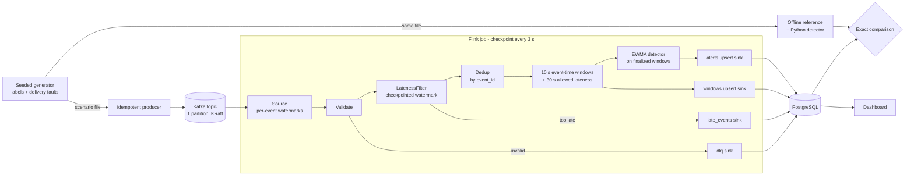

# Streaming anomaly detection with crash recovery

A **Kafka → Flink → PostgreSQL** pipeline that computes per-service window metrics and anomaly
alerts. It produces **exactly the same result as an independent offline reference**, through
duplicate, out-of-order, late and malformed events, and through worker kills, job restores and
database outages.

> **Status:** complete (milestones 1–6). 30/30 failure-injection runs match the reference exactly:
> 16 with the job idle, 8 while input is still arriving, 6 inside a checkpoint (re-run 2026-10-23).
> The learned detector (milestone 5) is evaluated offline. Not done: a managed-cloud variant.

## Architecture



The rules behind every decision (watermark, lateness, de-duplication, the guarantee claimed and not
claimed) are in [docs/02-semantics.md](docs/02-semantics.md). Components and trade-offs are in
[docs/01-architecture.md](docs/01-architecture.md).

## Results (single host, local processes)

### Correctness under failure: 30/30 runs exact

The 16 runs below inject each failure with the job idle. Eight more (`--inflight`) crash while
records are still arriving, so processed-but-uncheckpointed records and sink writes are replayed,
and six (`--mid-checkpoint`) crash while a checkpoint is in progress with its rows already written.
All 30 are exact (`results/suite.log`, details in [docs/03-recovery.md](docs/03-recovery.md)).

Each run replays a 10-minute scenario: about 51k records, with roughly 2% duplicates, 1% late, 0.3%
very late, and 0.2% malformed or unsupported-schema records, at about 46× real time. Each run then
compares Postgres with the reference **exactly**: all 240 windows, the set of late-dropped event ids,
dead-letter counts by reason, and every alert, including its floating-point score.

| Failure injected | Runs | Exact |
| --- | --- | --- |
| None | 5 | 5 |
| TaskManager SIGKILL at 20 / 35 / 50 / 80% of input | 4 | 4 |
| TaskManager SIGKILL, first record after recovery is very late (adversarial) | 1 | 1 |
| Job cancelled and resumed from its last checkpoint | 2 | 2 |
| Same, adversarial | 2 | 2 |
| Sink database stopped for 8 s mid-stream | 2 | 2 |

| Recovery (failure → every task running on restored state) | Time |
| --- | --- |
| TaskManager SIGKILL, restarted after 3 s | 7.3–12.1 s (failover noticed in 2.5–6.7 s) |
| Job cancel → resume from retained checkpoint | 2.5–5.7 s |
| Sink database down for 8 s | 8.5–10.1 s from outage start |

**Scope of the claim.** Final table contents are exact. Duplicate writes of identical values during
replay are expected. Not claimed: end-to-end exactly-once side effects, or survival of Kafka-log or
disk loss (one host shows process failure only).

### Bugs the exact comparison found (each reproduced, then fixed)

1. **Watermark lag:** periodic watermarks lagged about 9 s of event time at replay speed, so late-event decisions depended on timing. Fixed with per-event watermarks.
2. **Partition skew:** with 3 partitions, start-up skew let 8 very-late events through. Fixed with one partition, an ordered single-threaded chain, and a job-graph check on every run.
3. **Silent reordering:** a parallel validate step reordered records before the lateness decision. Fixed and guarded.
4. **Watermarks aren't checkpointed by Flink.** After a restore, a very-late first record re-created a purged window and overwrote a 197-event row with a 1-event aggregate. Fixed by moving the lateness decision into an operator with checkpointed state.
5. **Non-deterministic alerts:** alerts on first window firings differed between identical runs. The detector now runs on finalized windows, at the cost of 30 s more delay.
6. **Harness bugs:** the test harness leaked a job after an exception, and its recovery timer stopped too early. Both fixed.

### Anomaly detection (reported separately from correctness)

`python -m eval.detection_budget` → `results/summary/detection_budget.json`. Three detectors share
one alert rule (open after 2 flagged windows, close after 3 normal ones) and **one false-alert
budget**: each detector's sensitivity setting is chosen on dev seeds 1–20 to maximise recall with
at most 0.5 false alerts per run, then frozen. Results are on 30 held-out runs per traffic regime
(150 labelled anomalies of random severity each).

- **Stationary traffic:** a constant baseline, plus benign traffic-volume shifts.
- **Non-stationary traffic:** adds a slow "daily" latency wave and benign *permanent* level shifts
  (a deploy that makes a service 30–60% slower for good). Alerts during them count as false alerts.

| Detector | Stationary: P / R / F1 | False alerts per run | Non-stationary: P / R / F1 | False alerts per run |
| --- | --- | --- | --- | --- |
| EWMA z-score (the job's detector, re-tuned to z = 3.5 for this budget; the job runs z = 4.0) | 1.000 / 0.947 / 0.973 | 0.00 | 0.937 / 0.893 / 0.915 | 0.30 |
| Static thresholds from warm-up medians | 0.993 / 0.927 / 0.959 | 0.03 | 0.902 / 0.920 / 0.911 | 0.50 |
| **Learned** (gradient-boosted trees on causal window features) | 1.000 / 0.953 / 0.976 | 0.00 | **0.965 / 0.920 / 0.942** | **0.17** |

Learned minus baseline, with 95% bootstrap intervals over held-out runs:
- **Non-stationary:** significantly **fewer false alerts** than EWMA (−0.03 to −0.27 per run) and the
  static rule (−0.17 to −0.53). The recall differences are not significant.
- **Stationary:** significantly better recall than the static rule (+0.007 to +0.053). It is
  indistinguishable from EWMA.

**Reading this.** The learned detector's value is handling benign baseline changes without crying
wolf. EWMA's false alerts land mostly on level shifts: it stops updating its baseline while a
window looks anomalous, so a permanent shift looks like an anomaly that never ends. The lowest-severity
anomalies remain hard for all three. Median decision delay is 20 s for all; alerts are emitted
30 s later because detection runs on finalized windows.

**Protocol notes.**
- **Threshold selection:** the learned detector's threshold is chosen on out-of-fold dev predictions.
  A first version chose it on its own training data, where it looked perfect.
- **Causal features:** the features use past windows only (tested).
- **Deployment:** the learned detector is evaluated offline on windows the Flink job is proven to
  reproduce exactly. It is not deployed inside the job, which runs EWMA.

### Throughput and latency

- **Backlog drain:** 2.55 M records processed in 12.3–14.3 s with exact output, i.e. **178k–208k
  records/s**. No operator reported backpressure. The single-threaded ordered chain is the
  deliberate bottleneck.
- **Result latency** at 10× real-time replay (one factor varied, both runs exact):

| Sink flushing | p50 | p95 | max |
| --- | --- | --- | --- |
| Only on full batch and before each checkpoint (3 s) | 1.45 s | 2.47 s | 3.43 s |
| Also every 200 ms | **0.29 s** | 1.04 s | 1.79 s |

## Quick start

Requirements: Linux, Python 3.12, `uv`, about 2 GB of downloads. Everything else (JDK 17, Kafka 4.3.1,
Flink 2.2.1, Maven, PostgreSQL 16) is unpacked into `.tools/` with checksums verified, no system install.

```bash
scripts/setup_tools.sh
uv sync
(cd job && JAVA_HOME=../.tools/jdk ../.tools/maven/bin/mvn -B -Dmaven.repo.local=../.tools/m2 package)
uv run pytest                      # 52 tests: semantics, reference, generator, detector parity, feature causality
uv run python -m infra.stack up    # Postgres :19432, Kafka :19092, Flink UI :19081
eval/suite.sh                      # correctness suite (~10 min)
scripts/demo.sh                    # watch a crash and recovery on the dashboard (:19080)
uv run python -m eval.detection_budget   # EWMA vs static vs learned, fixed false-alert budget
uv run python -m eval.load capacity --rate-per-service 1000 --duration-s 600
uv run python -m infra.stack down
```

### macOS (Apple silicon)

Supported for local development. Linux behaviour is unchanged, and published numbers come from the
GX10, so Mac timings aren't comparable. The macOS code paths are tested on Linux but have **not yet
been run on a real Mac**. Minimum setup:

```bash
brew install openjdk@17 postgresql@17
export JAVA_HOME="$(brew --prefix openjdk@17)/libexec/openjdk.jdk/Contents/Home" PATH="$(brew --prefix postgresql@17)/bin:$PATH"
scripts/setup_tools.sh && uv sync
```

Memory and per-step details for a 16 GB Mac are in the portfolio's `RUN_ON_MAC_M4_16GB.md` guide.

## Repository layout

```text
semantics/   constants.json shared by Python and Java; parse, watermark and lateness rules
generator/   seeded scenarios with anomaly labels and delivery faults; Kafka producer
reference/   offline expected output (refuses scenarios with ambiguous decisions)
detector/    EWMA detector, Python reference implementation
job/         Flink job (Java 17): validate, LatenessFilter, Dedup, windows, EwmaDetector, UpsertSink
infra/       local stack manager: Postgres, Kafka (KRaft), Flink standalone
eval/        run_pipeline (exact comparison, crash modes), suite.sh, detection, load
dashboard/   live view of windows, alerts, dead letters and job state
docs/        numbered design record: 00-charter … 09-implementation-notes (index: docs/README.md)
```

## Design decisions

- **Lateness is decided in a checkpointed operator**, not by Flink's window operator: Flink's
  watermark restarts from −∞ after a restore. A tripwire table records anything Flink's own late
  path drops, and must stay empty.
- **Own upsert sink** (about 80 lines) instead of the JDBC connector: it makes the
  at-least-once + idempotent-upsert argument visible, at the cost of owning the code.
- **Python reference and Java job share one constants file.** A parity test requires bit-identical
  alerts from the two detector implementations.

## Docs

Start with [start.md](start.md) to run what needs no services, and [RUNBOOK.md](RUNBOOK.md) for the
Kafka/Flink/PostgreSQL steps. The design record is in [`docs/`](docs/README.md), with a reading order:

- [Charter](docs/00-charter.md): scope, non-goals, success criteria and which are met
- [Stream semantics](docs/02-semantics.md): watermark, lateness, dedup, the guarantee claimed
- [Recovery](docs/03-recovery.md): why final state is exact, and what the crash suite doesn't test yet
- [Evaluation](docs/05-evaluation.md): every number above, with its source file
- [Risks](docs/07-risks.md): claim hygiene and "is this exactly-once?"
- [Implementation notes](docs/09-implementation-notes.md): where the code departs from the plan

Planning documents: [SPEC.md](SPEC.md) · [PLAN.md](PLAN.md)

Part of a six-project engineering portfolio.
